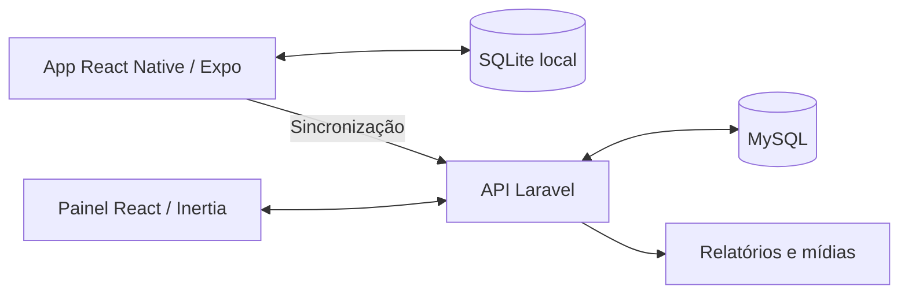

# Fiscaliza Mobile

### Operação em campo, registros offline e acompanhamento pela gestão

**React Native · Expo · TypeScript · SQLite · Laravel · React · MySQL**

Aplicação para fiscalização de condomínios que conecta o trabalho de campo a um painel de gestão. O fluxo reúne turnos, visitas, checklists, ocorrências e evidências, incluindo registros feitos sem conexão.

> Este repositório é uma apresentação técnica. O código-fonte do produto permanece privado. Dados operacionais, mídias, informações de clientes e configurações de acesso não fazem parte desta apresentação.

## O problema

Equipes em campo precisam registrar visitas e ocorrências mesmo com conexão instável. A gestão precisa reunir esses registros em uma visão diária, com contexto suficiente para acompanhar pendências e o que aconteceu em cada turno.

## A solução

| Aplicativo do fiscal | Painel da gestão |
| --- | --- |
| Abertura e encerramento de turno com quilometragem | Calendário e relatório diário da operação |
| Visitas com checklist, observações e ocorrências | Filtros por fiscal, condomínio e ocorrência |
| Registro de fotos, vídeos e pendências | Consulta das evidências e pendências |
| Rascunhos e armazenamento local offline | Relatório em PDF e visualização de trajeto |
| Sincronização quando a conexão volta | Gestão de cadastros e checklists |

## Arquitetura

## Decisões técnicas

- **Offline primeiro:** o registro não depende de conectividade contínua; o aparelho mantém os dados até o envio.
- **Reenvio seguro:** identificadores únicos permitem tratar sincronizações repetidas sem duplicar registros.
- **Separação entre campo e gestão:** o app prioriza captura; o painel prioriza consulta e acompanhamento.
- **Horários consistentes:** persistência em UTC e apresentação no fuso da operação evitam agrupar turnos no dia errado.
- **Rastreabilidade:** visitas, ocorrências, deslocamento e evidências compartilham o contexto do turno.

## Stack

| Camada | Tecnologias |
| --- | --- |
| Mobile | React Native, Expo, TypeScript |
| Persistência offline | SQLite |
| API | PHP, Laravel |
| Painel web | React, Inertia, Tailwind CSS |
| Banco de dados | MySQL |

## Escopo e validação

A documentação do projeto descreve testes de API, sincronização, painel e PDF. Esta apresentação não publica resultados de execução nem certifica prontidão para produção. Recursos de câmera e GPS dependem de validação em dispositivo real; GPS em segundo plano requer build nativo.

## O que esta apresentação demonstra

Integração mobile e web, modelagem de operações em campo, persistência local, sincronização e organização de informações para acompanhamento da gestão.

**Projeto apresentado por [Nycolas França](https://github.com/Scorpped).**
